[中文](README.md) | [English](README.en.md)

# TicketDesk · 知华科技活动售票、选座与扫码检票系统

**知华科技（上海如静知华信息科技有限公司）** · [官网](https://www.zhuatech.cn/)

一场200座讲座：观众选座领票，主办方维护票价和名单范围，现场工作人员在线扫码入场。TicketDesk把**活动与座位 → 限时预留 → 确认出票 → 在线检票 → 退票作废与库存释放**放在同一套持久化流程中。适合小型讲座、演出、展览和赛事主办团队，以及交付独立品牌系统的实施商；不面向大型抢票或多商户代收市场。

**公开源码学习版：源码公开、非商业使用。** 仅限个人学习交流，未经上海如静知华信息科技有限公司书面授权不得商用，见[LICENSE](LICENSE)。第三方许可独立适用；没有宣称已有外部客户、付费案例、生产运营或安全认证。

## 三个入口与实际能力

|使用端|已实现|
|---|---|
|观众端|注册/登录、公开活动、票种和规则网格座位、单座预留、订单恢复、票夹、独立二维码、浏览器打印/保存PDF、本人退票|
|主办后台|活动草稿/发布/停售、票种与座位CRUD、组织/活动授权、订单、退款/通知队列、分模式分币种报表/CSV、审计|
|手机检票端|授权活动、摄像头调用、JPEG/PNG票码图片识别和手输、成功/已使用/作废/活动不符/无效结果、在线防重复|
|账号与配置|BCrypt12、会话/CSRF、实时账号/密码/角色/组织校验、账号启停和密码重置、角色权限、菜单、组织/IANA时区、类别及参数、最后管理员保护|

- 每单一座、每票独立身份；35分钟预留，服务端冻结价格。相同请求恢复原订单，多人争最后一座只能一个成功；已有历史后锁定票价、布局、币种及时间规则。
- 免费票直接确认领票；DEMO明确模拟付款和退款；STRIPE模式提供真实REST Checkout适配和原文回调验签，核对会话、金额、币种及live/test模式，按支付身份去重。返回页不能证明付款，迟到或多收款进入独立退款任务。
- 检票按活动授权、组织和票状态检查，在线核销一次。未入场票在截止前申请全额退款即作废，确认退款成功才释放；未知结果保持原幂等键，平台确认失败后核对再重试。
- 邮件队列只发送本人订单及需登录的票夹链接；未配置、失败、待办和发送状态区分。不发送营销信息或公开票码。
- 中英文界面和业务名称、窄屏布局、搜索、状态筛选、分页、排序、保存反馈和表单变更确认；后台不返回密码散列或本人票码。详细规则见[业务](docs/BUSINESS.md)和[操作](docs/OPERATIONS.md)。

**边界：** 没有多座购物车、自由拖拽场馆图、原生App、离线多设备核销、多商户结算、微信/支付宝、税务发票、邮箱验证或自助找回密码。摄像头接口和支付/SMTP适配已写入，但**实体手机摄像头、真实Stripe商户收退款及真实SMTP投递未验收**；本地模拟合同测试不等于第三方完成接通。二维码由本系统检票页识别，不是普通网页链接。打印PDF依赖浏览器，未认证实体打印机/闸机；没有压测或生产容量保证。

## 运行页面

图片来自当前实际运行页面，资料标明QA，不是客户案例或虚构效果图。票夹截图使用隐私展示，隐藏二维码、备用票码及订单编号；实际票码生成与在线核销功能保留。

|页面|功能|
|---|---|
|登录|独立账号、注册及安全身份|
|观众活动|活动、场地、时间与票价|
|核心选座|真实库存座位图、预留|
|票夹|本人订单、隐私展示及退票|
|主办后台|活动、票种及工作人员|
|检票|在线核验与重复拒绝|
|报表|分模式分币种资金及入场|
|权限设置|账号岗位及系统配置|

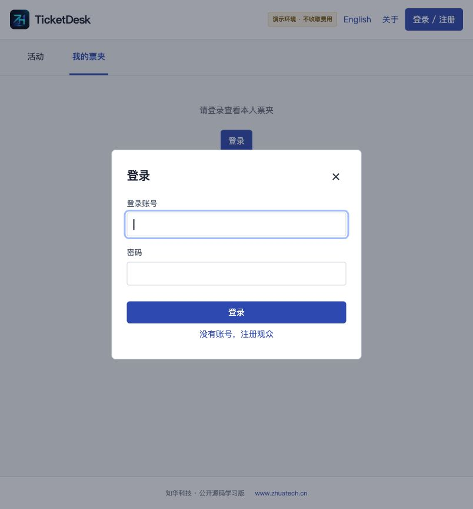
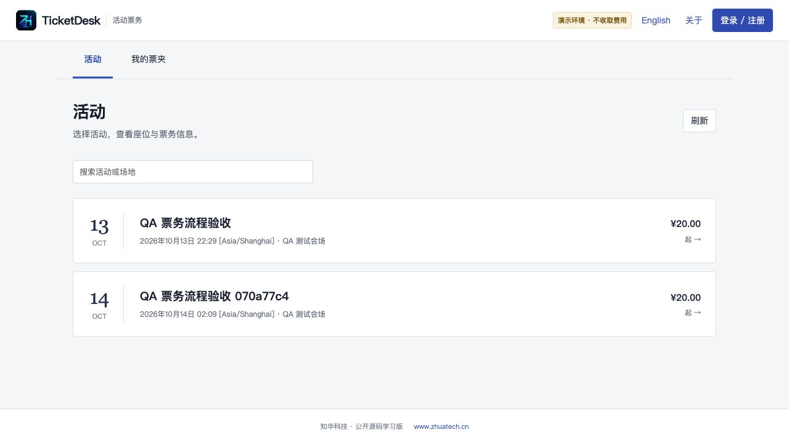
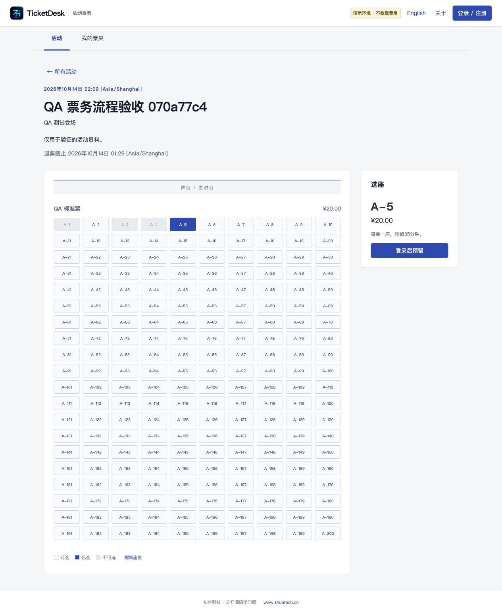
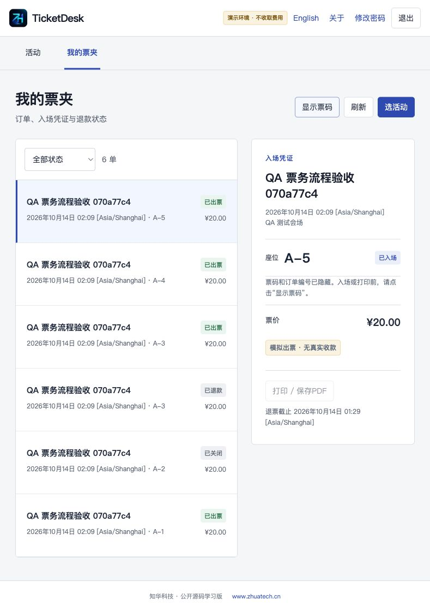
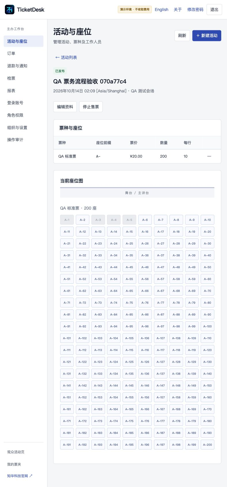
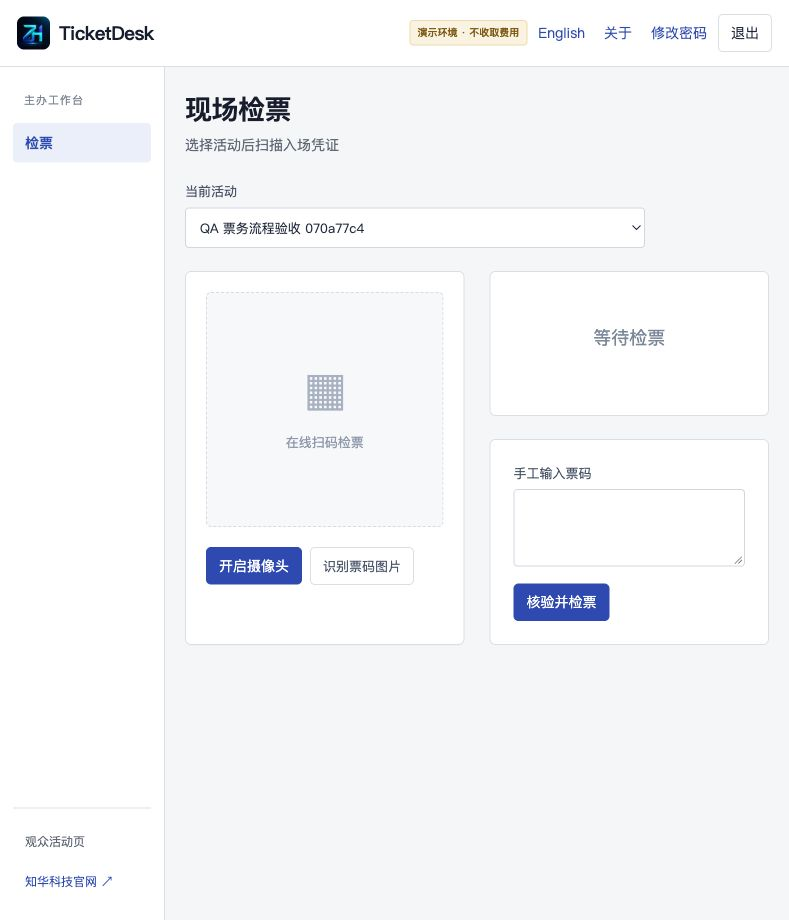
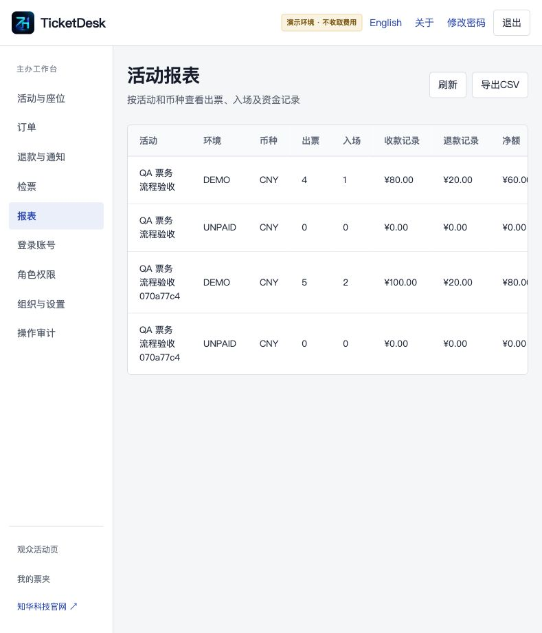
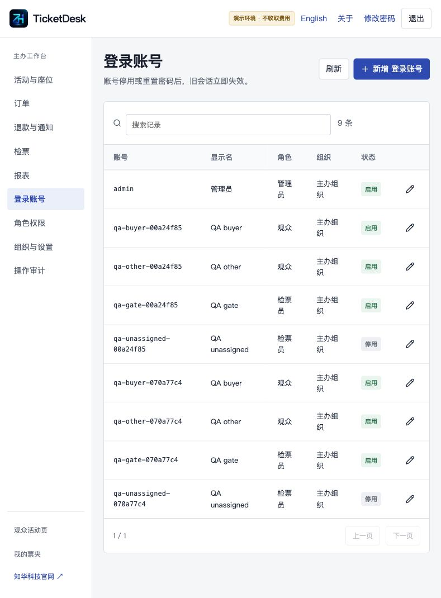
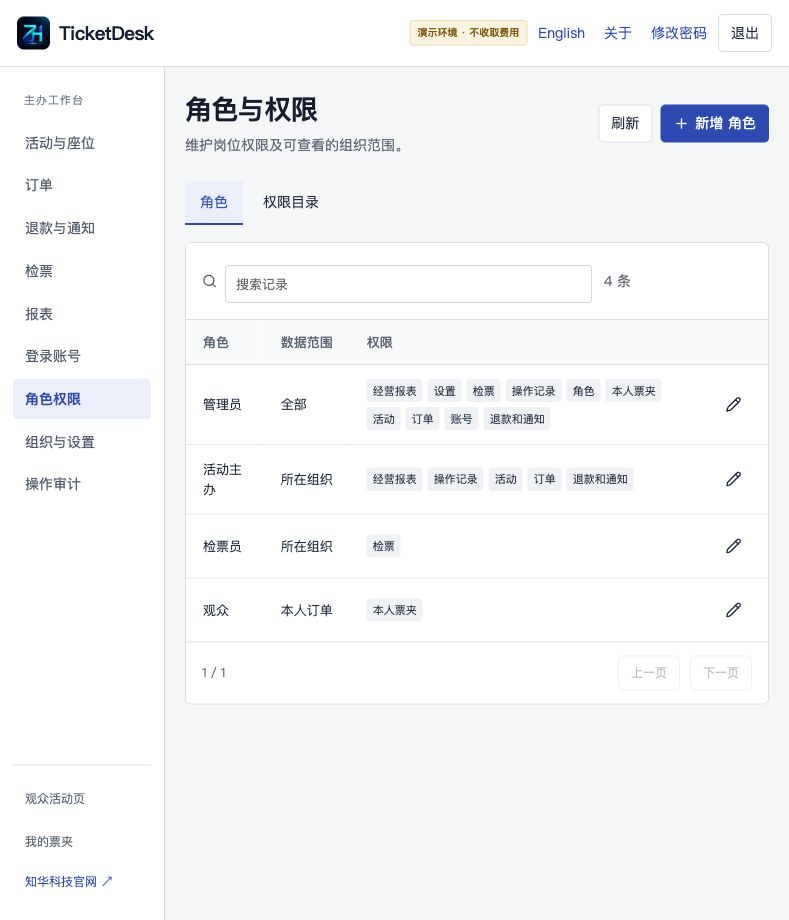
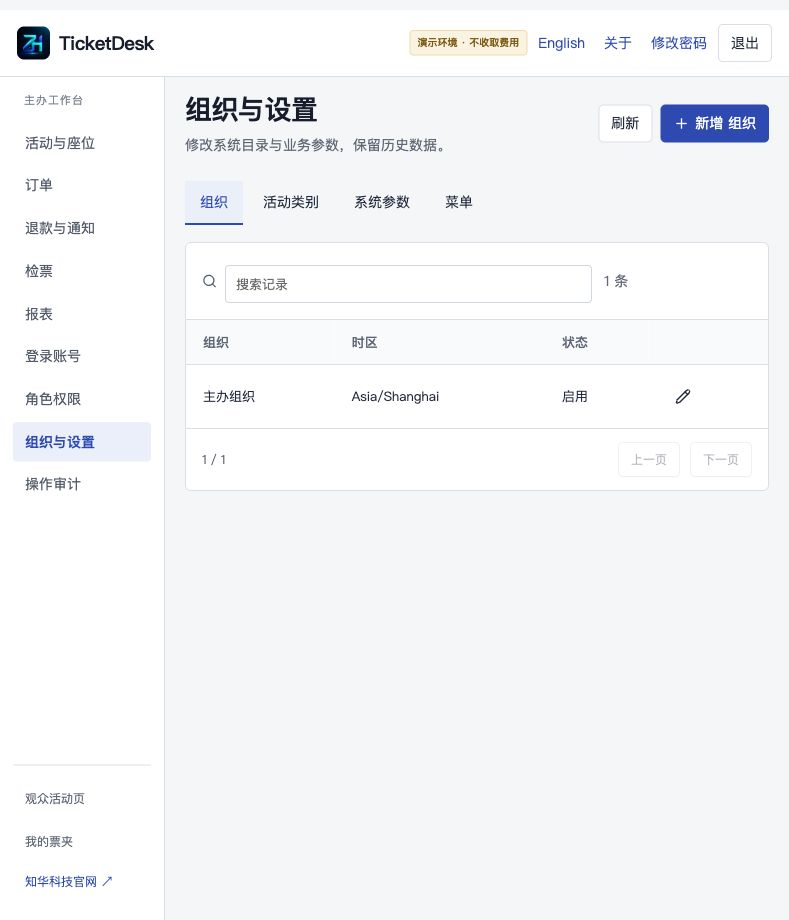
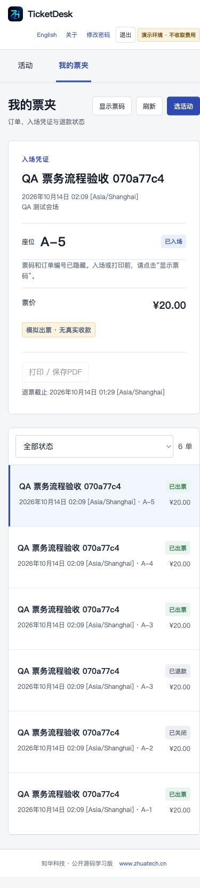
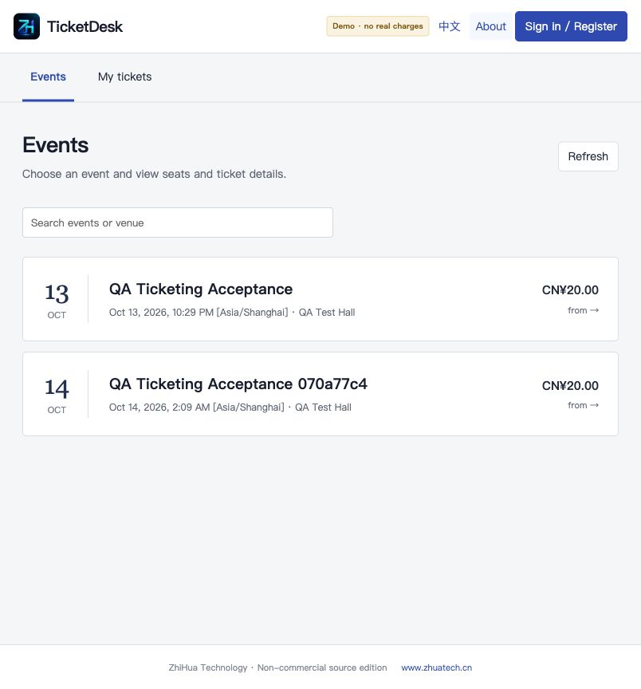

## 架构、目录与环境

Java21、Spring Boot4.0.7、Security/JPA/Flyway、MySQL8.4（MariaDB Connector/J3.5.10）；Vue3.5.43、Vite8.1.5、qrcode1.5.4、ZXing Browser0.1.5；Nginx同源代理。Node≥24.19、Maven3.9、Python3.10+、Docker及Compose v2，建议至少4GB可用内存。Docker启动不需要本机Java/Node。

```text
backend/              Java API、安全、票务事务、退款/邮件队列
  src/main/resources/ 配置及Flyway V1/V2/V3迁移
frontend/             Vue观众/主办/检票界面
  public/brand/       正式LOGO和两个原始微信二维码
scripts/              初始化、HTTP验收、持久化复核、备份恢复
compose.yaml          持久MySQL、后端、Nginx前端
compose.test.yaml     独立临时MySQL测试，不能并入生产
compose.dev.yaml      仅源码调试本机数据库端口
docs/                 业务、API、操作、安全、部署、测试、实拍截图
.github/workflows/    持续验证
```

浏览器→Nginx/api→实时权限及业务事务→MySQL；Flyway迁移与JPA结构校验同时开启。数据范围、状态和库存由服务器校验，前端不是安全边界。业务查询有每类10000条上限，适合小容量流程研究，未作高并发承诺。

## 安装、初始化和启动

```sh
git clone https://github.com/zhuatech-han/zhuatech-ticketdesk.git
cd zhuatech-ticketdesk
python3 scripts/init-env.py
docker compose -p ticketdesk config --quiet
docker compose -p ticketdesk up --build -d --wait --wait-timeout 1800
```

访问[本机前端](http://127.0.0.1:8160/)及[健康检查](http://127.0.0.1:8160/actuator/health)。默认账号`admin`；独立强密码在**私有.env的ADMIN_PASSWORD**，不提供固定共享密码。初始化拒绝覆盖.env（0600）；重启不会重置已有密码。手机上的localhost不是此服务器，应使用正确可达HTTPS域名。

空库执行[V1身份](backend/src/main/resources/db/migration/V1__identity.sql)、[V2票务](backend/src/main/resources/db/migration/V2__ticket_core.sql)、[V3活动与队列](backend/src/main/resources/db/migration/V3__events_integrations.sql)。初始化只有管理员、岗位、权限、菜单、类别和参数，不插入客户或虚构活动。登录后先配置组织、人员和活动，再添加票种并发布。

|配置|用途|
|---|---|
|MYSQL_ROOT_PASSWORD / DATABASE_PASSWORD|独立MySQL强密码，必填|
|ADMIN_USERNAME / ADMIN_PASSWORD|仅首次管理员，密码12–72字节含大小写字母和数字|
|TICKET_SIGNING_KEY|稳定256位以上票签名密钥，随私有环境保管|
|WEB_PORT / BIND_ADDRESS|默认8160 / 127.0.0.1，可覆盖占用端口|
|PUBLIC_URL / COOKIE_SECURE|可达公开地址；HTTPS反代启用Secure，改端口同步改URL|
|PAYMENT_MODE|DEMO或STRIPE；零价票为FREE；默认演示无实际款项|
|STRIPE_SECRET_KEY / STRIPE_WEBHOOK_SECRET|适格商户服务端及回调配置；真实模式缺必需配置拒绝启动|
|MAIL_ENABLED / MAIL_HOST / MAIL_PORT / MAIL_USERNAME / MAIL_PASSWORD / MAIL_FROM|SMTP通知，默认禁用，TLS和有界超时|
|SCHEDULER_ENABLED|默认true；隔离恢复设置false，避免外部动作|
|DATABASE_URL / DATABASE_USER|可选外部MySQL，verify-full及可信CA|
|MYSQL_DEV_PORT|仅compose.dev.yaml，本机默认33160|

.env.example只列配置名及安全说明，实际秘密不提交。STRIPE不保证上海主体可直接开户，[官方地区清单](https://stripe.com/global)未列中国大陆。部署、升级、外部数据库、可信私有备份与隔离恢复见[部署手册](docs/DEPLOYMENT.md)；追加迁移，不改已执行SQL。

## 测试、安全与故障

```sh
mvn -B -f backend/pom.xml spotless:check test
cd frontend
npm ci --no-audit --no-fund
npm run format:check
npm run lint
npm test
npm run build
cd ..
# 仅独立测试环境
docker compose -p ticketdesk-tests -f compose.test.yaml run --rm backend-tests
docker compose -p ticketdesk-tests -f compose.test.yaml down -v
# 仅独立DEMO整套环境，会创建QA资料
python3 scripts/quality.py --base http://127.0.0.1:8160
python3 scripts/verify-persistence.py --state output/ticketdesk-quality-state.json
python3 scripts/release-check.py
git diff --check
```

后端38项、前端17项；H2之外复验真实MySQL和完整DEMO HTTP流程。镜像构建实际执行测试，不跳过。检查全新数据库、健康、登录、200座活动、本人权限、冻结金额、出票/核销防重、退票、队列、报表及持久化；具体验收见交付记录。第三方真实环境、实体手机和容量仍须单独验证。

502先等待后端健康；空活动列表核对发布状态与活动授权；密码错误核对首次私有凭据；未知写入结果先刷新核对；SMTP未配置不能当成已发送。构建下载失败排查官方包源网络，不跳过测试。正式部署承担HTTPS、限流、备份、监控及隐私告知，见[安全](docs/SECURITY.md)、[测试](docs/TESTING.md)、[API](docs/API.md)。

贡献请提供脱敏复现及对应测试，遵循[AGENTS.md](AGENTS.md)。普通问题用仓库Issue；漏洞通过官网或商业咨询入口私下反馈，不公开业务资料和凭据。源码按现状提供，真实经营上线审查与使用风险由部署者承担。[第三方版权](docs/THIRD_PARTY.md)独立保留。

## 联系知华科技

仅限个人学习、技术研究与非商业交流，未经公司书面授权不得商用；收费部署、客户交付、SaaS、源码转售等需商业授权，README与根[LICENSE](LICENSE)一致。

商业授权或深度定制开发请联系知华科技。官网：<https://www.zhuatech.cn/>；微信`zhuatech`、`zhuatech2`。服务包括商业源码授权、私有部署、软件定制、部署实施和系统集成。

本项目由知华科技（上海如静知华信息科技有限公司）提供公开源码学习版本，主要用于个人学习、技术研究与非商业交流。未经书面授权不得商用。企业信息化建设、中小企业数字化转型、中小企业 AI 转型、私有化部署、软件外包、软件项目外包、软件实施、FDE 外包、OPC 技术支持及深度定制开发，请访问知华科技官网 [https://www.zhuatech.cn/](https://www.zhuatech.cn/)，或添加微信 zhuatech、zhuatech2 咨询。

<table><tr><td width="240" height="230" align="center" valign="middle"></td><td width="240" height="230" align="center" valign="middle"></td></tr><tr><td align="center">微信：zhuatech</td><td align="center">微信：zhuatech2</td></tr></table>
